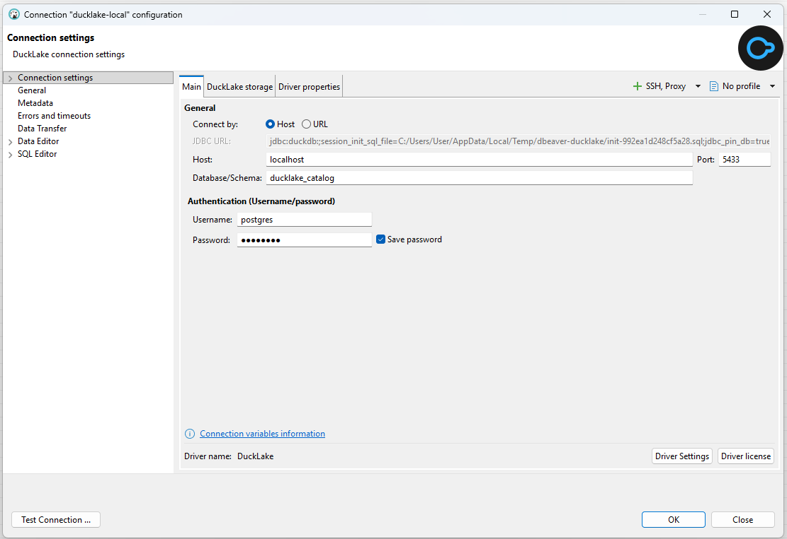
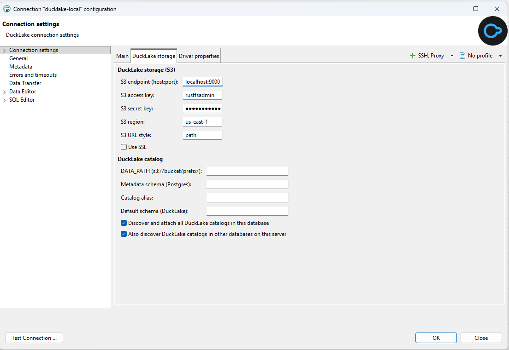
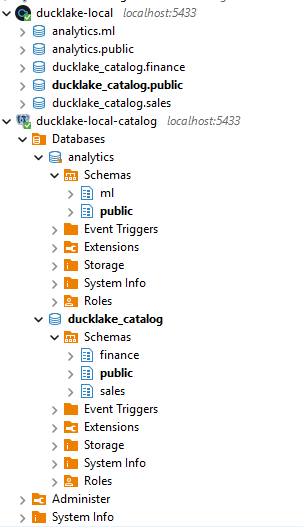

# DuckLake plugin for DBeaver

Adds **DuckLake** (DuckDB's lakehouse format — a SQL catalog + Parquet data on object storage) as a
first-class connection type in [DBeaver](https://dbeaver.io), so you can browse a lake's schemas and
tables in the navigator like any other database.

It's built on top of DBeaver's bundled DuckDB support and adds:

- A dedicated **DuckLake** driver/connection type (with the DuckLake icon).
- A connection page: standard **Host/Port/Database/User/Password** for the **catalog** database
  (Postgres), plus a **DuckLake storage (S3)** tab for the object store.
- **Reliable table browsing** — the plugin re-runs the `ATTACH` on *every* physical connection (SQL
  editor **and** the navigator's metadata connection). This is the fix for the well-known "DuckLake
  tables don't show up in DBeaver" problem.
- **Best-effort attaching** — each catalog is attached on its own, so one your Postgres role cannot
  read is skipped with a warning instead of killing the connection. Leaving the whole **DuckLake
  catalog** group blank is a normal setup, not a broken one.
- A clean tree — DuckDB's internal `memory`/`system`/`temp` databases are hidden, leaving just your
  lake(s).

Works with a local S3 (RustFS/MinIO), real **AWS S3** (leave the key blank to use the credential
chain), or a local-filesystem lake — empty fields are simply omitted from the generated SQL.

## Compatibility

- **DBeaver Community/PRO 26.1.x and 26.2.x** (tested against 26.1.1, 26.1.5 and 26.2.3). The plugin links against
  DBeaver's internal `org.jkiss.dbeaver.ext.duckdb` and `…ext.generic` APIs, which ship with
  DBeaver — so it needs a DBeaver version with compatible APIs. Other versions may require a rebuild
  (see [Build from source](#build-from-source)).
- Uses the DuckDB JDBC driver **2.0.0.0**, pinned exactly (pulled from Maven on first connect).
  DuckLake v1.0 needs DuckDB ≥ 1.5.2 and 2.0 reads DuckLake 1.0 catalogs as they are. Plugin 1.3.1
  and older declared the version in a form DBeaver treats as "newest release"; 1.3.2 to 1.4.0 pinned
  1.5.4.0; 1.4.1 moves to 2.0 (see [Troubleshooting](#troubleshooting) if `SELECT version()` does not
  say `v2.0.0` after the upgrade).
- **DuckDB 2.0's remote reads are tuned in the session init SQL.** 2.0 splits every remote read into
  2 MiB blocks fetched in parallel (its external file cache) and reads ahead. Measured on a 56 MB
  Parquet file behind 120 ms of latency: a two-column scan took 28 GETs instead of 1.5's 10, and the
  data editor's first page of 200 rows fetched the whole file (31 to 33 GETs, 56 MB) instead of 25 MB
  in 5. With `external_file_cache_remote_max_block_size` at 64 MiB the same scan is 1 GET, and with
  `read_ahead_depth = 0` the first page is back to 1.5's bytes; the plugin sets both on every
  connection. On a low-latency client next to the storage, 2.0's defaults are as fast or faster.

## Install

1. Download the two jars **and** `install.ps1` (Windows) / `install.sh` (Linux/macOS) from the latest
   [Release](../../releases) into one folder.
2. Run the installer (it copies the jars into DBeaver's `plugins/` and registers them in Equinox
   `bundles.info` — this DBeaver build does **not** load loose `dropins/`):

   **Windows** (DBeaver Community default location):
   ```powershell
   .\install.ps1
   # or:  .\install.ps1 -DBeaverPath "C:\Program Files\DBeaver"
   ```
   **Linux/macOS** (pass the install dir containing `plugins/`):
   ```bash
   ./install.sh /opt/dbeaver
   # macOS: ./install.sh "/Applications/DBeaver.app/Contents/Eclipse"
   ```
3. **Restart DBeaver once with `-clean`** so Equinox rebuilds from `bundles.info`:
   ```
   <dbeaver>/dbeaver -clean
   ```

Uninstall with `uninstall.ps1` / `uninstall.sh` (same arguments), then restart with `-clean`.

## Usage

**Database → New Database Connection → DuckLake.**

The **Main** tab points at the Postgres server that holds the DuckLake metadata. The **DuckLake
storage** tab holds the S3 settings and the catalog options.





| Field | Meaning |
|---|---|
| Host / Port / Database / User / Password | your **DuckLake catalog** (a Postgres database) |
| DuckLake storage (S3) → Endpoint | e.g. `localhost:9000`, or blank for AWS default |
| … Access key / Secret key | S3 credentials (blank key → AWS credential chain) |
| … Region / URL style / Use SSL | `path` style for MinIO/RustFS; SSL on for https endpoints |
| … DATA_PATH | storage location, e.g. `s3://bucket/prefix/`. Leave blank to browse. Setting it is what **creates** a catalog in the Metadata schema when that schema has none. A value that disagrees with an existing catalog's own location is dropped with a warning |
| DuckLake catalog → Metadata schema (Postgres) | the Postgres schema whose catalog you want **active**. Blank tries `public` first, then the other readable catalogs. A schema with no catalog in it is skipped with a warning |
| … Catalog alias | name for whichever catalog ends up active (defaults to its metadata schema, e.g. `public`) |
| … Default schema (DuckLake) | schema inside the active catalog that unqualified table names resolve to (default `main`) |
| … Discover and attach all DuckLake catalogs in this database | on by default. Attaches every DuckLake catalog in the database, one per Postgres schema. Off attaches only the Metadata schema one |
| … Also discover DuckLake catalogs in other databases on this server | on by default. Attaches the catalogs of every other database you can connect to |
| Results → Stream result sets | off by default. On passes `jdbc_stream_results=true` to the DuckDB driver, which fetches a result in chunks instead of holding it all in memory. Turn it on only for huge exports: a streamed result breaks as soon as DBeaver runs another statement on the connection (see Troubleshooting) |

Everything in the **DuckLake catalog** group is optional. Leave all four fields blank and the plugin
attaches every catalog your Postgres role can read, then starts you in the first of them.

Connect, expand the lake → schema → **Tables**, and browse. To change what's hidden, see
**Connection settings → Filters** / the navigator's *Show system objects* toggle.

### Many catalogs, one connection

A DuckLake catalog is a set of `ducklake_*` metadata tables in one Postgres schema. DuckDB's
`METADATA_SCHEMA` option picks that schema and defaults to `public`. So one Postgres server can hold
many catalogs, as several schemas in one database, spread over several databases, or both.

A single DuckLake connection shows all of them:

- Every schema in the database you entered that holds a DuckLake appears as its own top-level node.
- The plugin also probes every other database on the server you have `CONNECT` rights on and adds
  their catalogs too.
- Each one is attached separately. A catalog your role cannot read is skipped with a warning in
  DBeaver's error log, and the rest still show up.

One of them is the **active** catalog, the one new SQL editors start in. The plugin tries the
**Metadata schema (Postgres)** you entered first, or `public` when that field is blank, then the
remaining schemas of your database in alphabetical order, then the other databases. The first one
that attaches wins. So a read-only role that can read `bronze` and `silver` but not `public` ends up
in `bronze`, with a warning about `public`, rather than failing to connect.

Only schemas that already contain a DuckLake are attached. DuckLake's `ATTACH` creates a catalog when
the schema has none, so a typo in **Metadata schema**, or a blank field on a server whose catalogs
live elsewhere, would otherwise leave an empty catalog behind. You get a warning and the next
candidate instead. Filling in **DATA_PATH** is the one way to say you do want a catalog created
there.

Every catalog is attached under its metadata schema name, so SQL needs no quotes:
`SELECT * FROM ethereum.bronze.blocks`, `SELECT * FROM sales.main.deals`. When two catalogs would get
the same name (the same schema in two databases, found by "Also discover DuckLake catalogs in other
databases"), the one in your own database keeps the plain name and the other becomes
`<database>_<schema>`, e.g. `analytics_public`. The Postgres database and schema each catalog comes
from show in the node's tooltip and description. **Catalog alias** renames whichever catalog ends up
active.

Since 1.2.2. Earlier versions named catalogs `<database>.<schema>` (e.g. `"ducklake_catalog.sales"`),
which had to be quoted in SQL. Existing connections with a Catalog alias set keep that alias; the
other catalogs move to the new names on the next connect, so update saved scripts that quote the old
dotted names.

Here `ducklake-local` is a DuckLake connection to the demo stack below, and `ducklake-local-catalog`
is a plain PostgreSQL connection to the same server with **Show all databases** on. The DuckLake
connection lists one node per catalog. The Postgres connection shows the same five catalogs from the
storage side: each is a schema in `analytics` or `ducklake_catalog` that holds the `ducklake_*`
metadata tables. Bold marks the active catalog, database and schema.



Discovery runs when you connect, so reconnect to see a catalog created later. Untick both discovery
options to mount only the **Metadata schema** catalog. Connecting fails only when not one catalog
could be attached, and the error dialog then lists every reason.

**Default schema (DuckLake)** makes every connection start in that schema of the active catalog. The
plugin runs `USE "<catalog>"."<schema>"` on each connection, so `SELECT * FROM leads` works without a
prefix. If the schema doesn't exist you get a warning and the catalog's own default schema. Picking
another catalog in DBeaver's active catalog selector puts you in that catalog's `main` schema.

## Query guard

DuckLake keeps the data on object storage and runs the query in DBeaver's own DuckDB. A `GROUP BY`
over a fact table therefore downloads the projected columns of every file in that table, and DBeaver
gives no sign of it until the query finishes. The query guard warns you first and tells you
afterwards what was actually read.

Before a read query (`SELECT`, `WITH`, `FROM`, `TABLE`, `PIVOT`) runs from the SQL editor, the
plugin:

1. runs `EXPLAIN` on it, which only plans and reads nothing;
2. takes each DuckLake table scan from the plan, with the columns it projects;
3. looks up the table's data and delete files with `ducklake_list_files` and estimates
   `file bytes × projected columns / table columns + delete file bytes`;
4. adds the scans up and, above the threshold, asks before running the query.

The dialog lists each table with its file count and estimate. **Cancel** stops the query, **Run**
runs it. Tick **Don't ask again for this connection** to switch the guard off for that connection;
the setting is saved with it.

After the query, the SQL editor's **Output** panel (the editor's *Show server output* button) gets
a line like `Query guard: read 47 MB from object storage (114 requests) in 0.29 s`. That number is
measured: the plugin turns on DuckDB's HTTP log for its own connections and sums the `GET` responses
of the statement.

Change it on the connection's **DuckLake storage** tab, under **Query guard**: untick the box to turn
it off, or set **Warn above (MB)** (default 100). New connections and connections saved before 1.3.0
start with the guard on. The same group holds **Newest-file columns**, which decides which data file
a table opens on (see [Opening a table shows its newest data](#opening-a-table-shows-its-newest-data));
empty by default.

What the estimate does not know:

- **The cache.** DuckDB caches the files it reads in memory, so running a query a second time often
  reads nothing. The estimate assumes a cold start.
- **Filters.** DuckLake skips files using the catalog's min/max statistics, and plain `EXPLAIN` can't
  show that. For a filter that bounds an integer column (`height BETWEEN a AND b`, `id = n`)
  the guard asks the catalog itself which files overlap the bounds and counts only those, so a
  height lookup on a big table no longer asks. Other filters (strings, timestamps, `OR`) are shown
  as "up to" the full table. Row groups skipped inside a file are not counted either way.
- **Column widths.** The estimate uses the share of columns, not their sizes. Two narrow columns of
  an eight-column table count as a quarter of the table even if the other six hold the large text.
- **Catalog traffic.** Round trips to the Postgres catalog and inlined rows stored there are not
  counted, in the estimate or in the measurement.
- `LIMIT` without `ORDER BY`, aggregate, join, window or `DISTINCT` above the scan stops early. It
  still opens every file of the table to read its Parquet footer (one request per file, whatever the
  thread count), then reads the first rows. The guard counts every footer plus the projected columns
  of the largest file, and says so in the dialog and the Output panel. That matches the measurement
  within 2% when a file is one row group; for files of many row groups it overstates (12 times for
  14 MB files of 12 row groups). `ORDER BY ... LIMIT` reads the sort column of the whole table and
  is counted that way.
- Statements with bound parameters (`?`, `:name`) run through a prepared statement and are not
  checked.
- Queries inside a transaction (manual-commit mode, or after a `BEGIN` you typed) are not checked.
  Any failed statement aborts an open DuckDB transaction, and the guard won't risk that for an
  estimate.

The Output panel also gets the estimate before the query runs (`Query guard: estimated 2.5 MB ...`),
so you can hold it against the measured line.

The planning step usually takes 20 to 30 ms and the measurement about 15 ms. A filtered scan adds
one catalog round trip for the statistics. If planning and the
catalog lookups together take more than 3 s, the guard gives up on the estimate, says so in the
Output panel, and runs the query. If you already run DuckDB logging yourself (`CALL enable_logging`),
the guard leaves the log alone and skips the measurement.

### Opening a table shows its newest data

Double-clicking a table runs `SELECT * FROM <table>` with DBeaver's fetch limit (200 rows). The DuckDB
driver ignores that limit, so the query downloads the whole table before DBeaver shows the first
200 rows. On a lake table of 2,815 files that is 220 GB.

So the first time a data editor opens a DuckLake table, the plugin fills in the filter bar with the
range of one integer column in the table's newest data file, e.g. `id BETWEEN 975000 AND 999999`.
The range comes from the catalog's statistics in one round trip. DuckLake then reads that one file
(plus any file whose range overlaps it). There is no `ORDER BY`; rows come in file order.

By default "newest" is the data file committed last, and the column is an integer identity-partition
column, else the first integer column. That works for tables that only grow at the end. If your
tables are sorted by a column such as a sequence number, a block height or an epoch day and get
compacted or backfilled, the file committed last is often an old range rewritten by compaction.
For those, enter the column names on the connection's **DuckLake storage** tab, under **Query
guard**, in **Newest-file columns** (provider property `ducklake.newest_file.columns`):
comma-separated, case-insensitive, in order of preference, e.g. `height, seq`. Then "newest" is the
file whose statistics for one of those columns reach the highest, and the filter uses the first of
them that is an integer column with statistics in that file; a table without any of them falls back
to the default.

A table with no data file yet, or without a usable integer column, opens without a filter. Clear
the filter bar to see the whole table; the query guard then warns as before, and the filter does
not come back until you open the table in a new editor.

## Troubleshooting

- **`SELECT version()` still says `v1.5.4` after installing 1.4.1**, or the connection fails on
  `SET external_file_cache_remote_max_block_size` (a 1.5 driver does not know the 2.0 settings).
  Restart DBeaver with `-clean`: the driver's library entry changed, DBeaver drops the stored
  resolution, and the next connect opens the driver download dialog once: click **Download** (it
  reuses a cached 2.0.0.0 jar when there is one). If it still says 1.5.4, open **Database > Driver
  Manager**, edit the DuckLake driver, and on the Libraries tab
  click **Reset to defaults**.
- **The connection dialog shows only Main and Driver properties, with no DuckLake storage (S3)
  tab**, and connecting fails with `Secret Validation Failure ... Credential Chain: 'config'`. DBeaver
  did not pick up the plugin's page registration and fell back to the DuckDB page, so there was
  nowhere to enter the S3 key. DBeaver 26.2 looks connection pages up through a different extension
  point than 26.1, and plugin 1.2.0 and older register only the 26.1 one. Install 1.2.1 or newer and
  restart DBeaver with `-clean`.
- **`SQL Error: Invalid Input Error: Invalid result set`** (or `Invalid Input Error: Attempting to
  execute an unsuccessful or closed pending query result`) on a query that takes more than a second
  or two. Plugin 1.2.1 and older always connected with `jdbc_stream_results=true`. The DuckDB driver
  invalidates a streamed result set as soon as another statement runs on the same connection, and
  DBeaver runs metadata queries on that connection while a slow result is still being fetched. Since
  1.2.2 streaming is off unless you tick **Stream result sets** on the DuckLake storage tab, so the
  result is materialized and nothing else can break it. That costs memory for a very large result;
  for a huge export, tick the option, run the export, and expect the editor to misbehave while it
  runs. `jdbc_pin_db=true` stays on either way.

## Try it locally (optional demo stack)

`docker/` spins up a complete local DuckLake to test against: **RustFS** (S3) + **Postgres**
(catalog), seeded with five catalogs over two databases.

```bash
cd docker
docker compose up -d      # S3 on :9000 (console :9001), Postgres on host :5433
```

| Postgres database | Metadata schema | Appears in DBeaver as | Tables |
|---|---|---|---|
| `ducklake_catalog` | `public` | `public` | `main.customers`, `main.orders`, `main.blocks` (1,000,000 rows in 40 files, for the query guard) |
| `ducklake_catalog` | `sales` | `sales` | `main.deals`, `emea.leads` |
| `ducklake_catalog` | `finance` | `finance` | `main.invoices` |
| `analytics` | `public` | `analytics_public` (the plain name is taken) | `main.events` |
| `analytics` | `ml` | `ml` | `main.features` |

Make a DuckLake connection with Host `localhost`, Port `5433`, Database `ducklake_catalog` and
User/Password `postgres`. On the storage tab set Endpoint `localhost:9000`, key and secret
`rustfsadmin`, URL style `path`, SSL off, and leave the rest blank. All five catalogs show up. To start
SQL editors in the `emea` schema of `sales` instead, set Metadata schema `sales` and
Default schema `emea`.

`quickstart/` shows how to get the same result with the **stock** DuckDB driver (no plugin), for
reference.

## Build from source

Needs JDK 21 and a DBeaver install to compile against (no Maven/Tycho):

```powershell
.\build.ps1          # -> plugin/dist/*.jar
```

Then run `install.ps1` from `plugin/dist` (or copy the jars next to `install.ps1`).

`.\test.ps1` runs the unit tests for the query guard's plan parser and estimator against captured
DuckDB 1.5 and 2.0 plans.

## How it works

- The datasource extends DBeaver's `GenericDataSourceProvider`; `getConnectionURL` writes a
  `session_init_sql_file` (INSTALL/LOAD extensions, then `CREATE SECRET` when the lake is on S3) and
  returns `jdbc:duckdb:;session_init_sql_file=…;jdbc_pin_db=true`. The DuckDB driver runs that file
  on every connection.
- The file holds no `ATTACH` and no `USE` on purpose. A statement that fails there fails the whole
  connection, with nothing able to catch it, and a catalog the Postgres role cannot read is exactly
  the case that must not do that.
- The `ATTACH`es happen from the data source instead, on the first execution context DBeaver opens.
  It asks Postgres through DuckDB's `postgres_query` which schemas contain a `ducklake_metadata`
  table, first in the connection's database and then in each other database, then attaches each
  catalog it finds inside its own try/catch and runs `USE` on the first one that worked. The one
  statement that has to succeed is the read-only Postgres passthrough the probing runs through:
  if that fails, the host or the credentials are wrong.
- Each later connection DBeaver opens (SQL editors run on their own DuckDB instance) replays the
  `ATTACH` statements that worked, one catalog at a time, and the same `USE`. A catalog that has gone
  offline since is skipped with a warning instead of blocking the connection.
- The metadata model extends DBeaver's DuckDB model. It marks `memory`/`system`/`temp` as system
  catalogs (hidden via *Show system objects = off*) and lists a lake's tables via `duckdb_tables()`.

## License

Apache License 2.0 — see [LICENSE](LICENSE) and [NOTICE](NOTICE). Builds on DBeaver's Apache-2.0
code (© DBeaver Corp).
